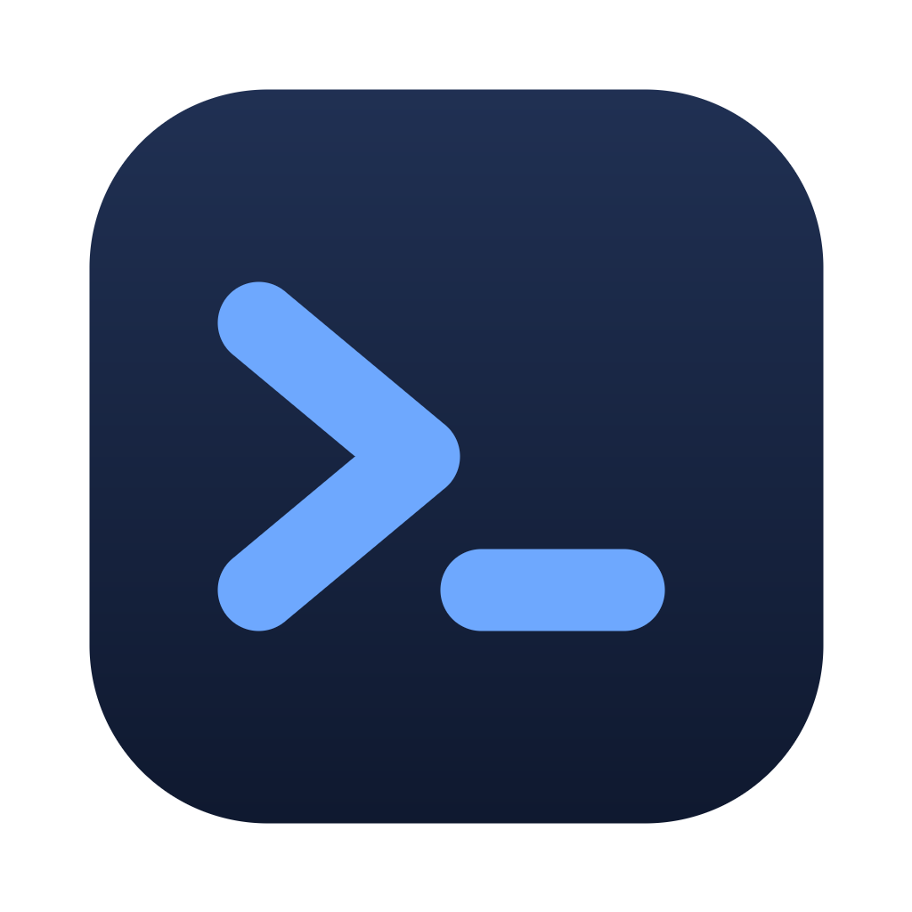

<p align="center">
  
</p>
<h1 align="center">Houston</h1>

A **cross-platform coding agent**: **bring your own model**. Point it at Claude, GPT,
Gemini, any OpenAI-compatible API, or a local model (Ollama / LM Studio), give it
a project folder, and let it read, edit, search, and run code, with every action gated
by an approval flow and, where the OS supports it, confined to a sandbox.

**Website and downloads: [houstoncode.ai](https://houstoncode.ai)**

> **Beta.** Houston is pre-1.0: expect rough edges, and settings or behavior may change
> between releases. Please [report problems](https://github.com/houston-code/houston/issues)
> you run into.

Built with Electron + React + TypeScript. Runs on macOS 13 Ventura or newer
(Apple Silicon and Intel), Windows 10 or newer (x64), and Linux x64 (glibc 2.35+).

Open source under the [Apache License 2.0](LICENSE).

## Features

- **Any model, your keys.** Anthropic (Claude), OpenAI (GPT), Google (Gemini),
  any OpenAI-compatible endpoint, and local models via Ollama or LM Studio. Claude
  also runs through your cloud account (Amazon Bedrock, Google Vertex AI, or
  Microsoft Foundry), and GPT through your own Azure OpenAI deployments. Add a
  known host (OpenRouter, Together, Fireworks, Groq, and more) in one click, point
  at any custom endpoint, and fetch live model lists in Settings. The searchable
  model picker shows each model's context window, price, and capability badges
  (tool calling, vision, reasoning), read live from the host where it advertises
  them, so it warns before you pick a model that can't call tools. Name
  `fallbackModels` in settings.json and a turn the selected model can't serve
  moves on to the next one. Each chat keeps its own model, reasoning effort, and
  approval mode, so switching in one chat never changes another; new chats start
  from the defaults (**Use for new chats** makes an open chat's settings the
  defaults).
- **Image attachments.** Drag-drop or paste images (PNG/JPEG/GIF/WebP) into the
  composer to send them to a vision-capable model: screenshots, diagrams,
  mockups. The affordance is offered only when the selected model supports
  vision. Thumbnails show inline and the images persist with the conversation.
  The agent can also `read_file` an image or PDF in the project and view it
  directly, and images a tool produces (a `read_file` image, a `view_localhost`
  screenshot) reach any vision-capable model, on Anthropic, OpenAI, and Gemini
  alike. (PDFs are Anthropic-only; elsewhere they fall back to a text placeholder.)
- **Agentic tool use.** The agent can `read_file`, `write_file`, `edit_file`,
  `multi_edit`, `apply_patch`, `notebook_edit`, `list_dir`, `glob`, `search_files`,
  `ast_grep`, `run_shell`, `git_status`, `git_diff`, `web_fetch`, `web_search`,
  `gh_pr_*` (pull requests), `todo_write`, `pr_sweep`, and `ask_user` to actually
  do the work, not just describe it. When a turn is all
  reads (e.g. open five files at once), they run **concurrently**; anything that
  writes, runs a command, or needs approval stays sequential. Edits are matched
  **resiliently**: if the model's snippet drifts from the file by indentation or
  whitespace, Houston still locates and applies it instead of failing, and shows the
  model the lines it actually changed. Reads come back **line-numbered**, and the
  agent must have read a file, unchanged since, before it overwrites or edits it, so
  an edit you make in your editor mid-turn is never clobbered.
  `search_files` ships with a bundled **ripgrep**, so fast content search works
  out of the box without anything installed on your PATH (it falls back to a
  built-in scan if the binary is ever unavailable).
- **Jupyter notebooks.** `read_file` on an `.ipynb` shows it as **numbered
  cells**, with each cell's source and a summary of its output (a plot is named,
  not dumped as base64), instead of the raw JSON a notebook is stored as.
  `notebook_edit` then edits a cell by that same number, so the rest of the
  document (other cells, their outputs, kernel metadata) is left exactly as it
  was, and replacing a code cell clears the now-stale output it used to produce.
  Files that turn out to be binary are reported as such rather than being decoded
  into pages of nonsense.
- **Structural code search.** `ast_grep` matches code by its **syntax tree**
  rather than text, using a bundled [ast-grep](https://ast-grep.github.io)
  binary. Meta-variables make it precise (`console.log($A)`,
  `function $F($$$) { $$$ }`, `useEffect($CB, [])`), so the agent can find
  calls, declarations, and JSX without the false positives of a regex. Pass the
  language (`ts`, `tsx`, `py`, `rust`, …).
- **Web search.** Pick a search provider and supply its API key (Settings →
  *Tools* → *Web search*) and the agent can `web_search` the web for current
  information. Like `web_fetch`, it asks before it leaves the machine (once per chat
  in full auto, unless Settings → *Permissions* → *Web reads in full auto* lets it
  run without asking).
- **See its own localhost.** After starting a dev server (a background
  `run_shell`), the agent can `view_localhost` to load the page in an offscreen
  Electron window, screenshot it, and read back the browser console, closing the
  build → look → fix loop without a human eyeballing the page. The screenshot
  comes back through the same vision pipeline as pasted images, so a
  vision-capable model views it directly, and it shows inline in the transcript.
  Only loopback hosts (`localhost`, `127.0.0.1`, `::1`) are allowed (public URLs
  go through `web_fetch`), and, being local network egress, it asks for approval
  (once per host in full auto, and once more for a call that clicks or types). Pass a `selector` to capture just one element. It can
  also run steps first (fill a field, click, press a key, wait for an element,
  check that some text is or isn't shown) to try a flow such as logging in and get a
  pass or fail for each step, or capture the page at several viewports and color
  schemes in one call.
- **Mockups and image galleries.** `render_mockup` turns an HTML mockup file in the
  project into screenshots at desktop, tablet, or mobile sizes, in a locked-down
  hidden browser with no network, and `show_images` shows image files the agent
  produced as a gallery. The full-size viewer has a before/after compare slider,
  plus Copy, Save, Show in Files, and Open file.
- **Diagrams in replies.** A Mermaid or SVG block in a reply is drawn as a diagram
  in the desktop app, with a switch to see the source. Mermaid renders in a hidden
  window with no network, and the result is shown as an image. Sandboxed
  interactive HTML visuals are off by default (Settings > *Appearance*).
- **Live preview panel.** When the agent starts a dev server (a background
  `run_shell`), Houston detects the loopback URLs it prints and offers a **Preview**
  panel: a resizable right-hand dock that renders the running page live and
  interactively, right beside the chat. A script that starts several servers (a
  client and its API) shows the page it labels `Local:`, with a picker for the
  others. Multiple servers stack top-to-bottom (up to three), each showing its full
  URL with reload, copy, and open-in-browser controls; you can also add a
  `localhost` URL or port by hand. Each chat's Preview shows the servers its own agent
  started, so switching chats switches the pages. The pages render in isolated, sandboxed,
  loopback-pinned views with the same network guards as `view_localhost`, so
  untrusted dev-server output can't reach your network.
- **Chat status at a glance.** Every chat in the sidebar carries a status dot: amber
  when it is waiting on you (an approval, a question, a plan, a server asking for input,
  with the reason under the title), a grey pulse while it works, red when its last run
  failed, and blue when it finished while you were elsewhere. Mark any chat unread or
  read from its ⋯ menu or with ⌥U (Alt+U), or from a specific reply with **Mark unread
  from here**. Reopening an unread chat lands on a "New" divider above what you missed.
  Mark everything read from the filter menu, or sort the chats that want attention to
  the top. Collapsed groups, the collapsed sidebar, and the app icon (Dock badge, or a
  taskbar dot on Windows) count what is waiting; a title-bar pill jumps to the next
  chat that needs you, and clicking a notification opens its chat. `/resume` in the
  terminal marks chats the desktop app has unread or failed.
- **Background tasks.** The tasks button in the titlebar shows a pulsing count while
  terminals or commands the agent backgrounded in the open chat are running, and opens
  a **Tasks** tab in the same right-hand dock as Preview. Another chat's backgrounded
  commands show when that chat is open; terminals show in every chat. Each row names the command that does the
  work (setup like `cd` and virtualenv activation is stripped), its port and folder;
  expand it for the full command, recent output, and Stop or Open preview. A shell that exited but left a server running is flagged, with a button to
  stop the leftover process. The panel never opens by itself.
- **Integrated terminal and Files panel.** A resizable, multi-tab terminal panel runs
  full PTY sessions (interactive programs, colors, resize) next to the chat. The
  Files panel browses the project like a file manager, with an in-app preview
  (syntax-highlighted code, images) and an Open action that hands a file to its
  default app. Each chat's ⋯ menu also has **Open in**, which opens the chat's
  folder in a detected editor or reveals it in the file manager.
- **@-mention files.** Type `@` in the composer to fuzzy-search project files and
  drop a path into your message, with no need to paste or describe where things live.
- **Slash commands.** Type `/` for a command menu. The desktop app and the terminal
  share one set of built-ins, among them `/new` (or `/clear`), `/compact` (summarize
  older turns to free up context now), `/plan` `/ask` `/auto` `/full` (switch
  approval mode), `/model`, `/reasoning`, `/review` (adversarial review), `/rewind`,
  `/undo` and `/redo`, `/cost`, `/doctor` (check your setup), `/skills` and
  `/agents` (list them), `/agent <name> <task>` (hand a task to one of your agents),
  and `/help`; see the [terminal table](#interactive-terminal) for the rest.
  Any Markdown file in `.houston/commands/` (or `~/.houston/commands/` for every
  project) becomes a custom command: its contents are a prompt template
  (`$ARGUMENTS` is filled in with whatever you type after the command name, `$1`,
  `$2`, … with the individual words).
- **Remember an instruction.** Start a message with `#` (`# always run the linter
  before committing`) and Houston appends it to the rules file it already reads,
  `AGENTS.md` in the project or `~/.houston/AGENTS.md` for everywhere.
- **Memory across sessions.** The agent saves what a later session should know (your
  preferences and corrections, project facts the code doesn't show) and recalls it in
  later conversations. Memories live in `~/.houston/memory`, never in the project.
  Review, edit, or delete them in Settings → Memory or with `/memory`; once a chat has
  read web or GitHub content, every save asks first.
- **Steer or queue while it works.** Keep typing while a run is in progress. **Enter**
  steers the running turn: the agent reads your message before its next step, and
  the message is labelled **Steered**. **⌘+Enter** (Ctrl+Enter on Windows and Linux)
  queues it instead, to be sent as the next turn. Line up as many as you like (a bar
  above the composer lists them, and you can drop any or clear them all); when the
  turn finishes they're combined into one next message and sent automatically. The
  queue is per-chat and lives in the background, so a follow-up still fires when its
  chat's run finishes even after you've switched to another conversation. If the
  turn fails or you stop it, the queue is held: retry (or send) it deliberately
  rather than firing onto a broken turn. A slash command typed mid-run runs as a
  command (`/compact` waits for the turn to end).
- **Subagent delegation.** The agent can `dispatch_agent` to hand a focused,
  read-only question to a subagent with its own fresh context: it reads, globs,
  and searches the project and reports back, keeping the main agent's context
  clean. `dispatch_writable_agent` delegates a whole implementation task to a
  subagent that can also edit files and run shell commands, confined to the
  project; that dispatch is approval-gated, so one consent covers the delegated
  task's local actions. Permission rules still apply inside either tier: a `deny`
  (including a managed-policy or project one) refuses the subagent's call, and an
  `ask` rule, a credential-file read (a `.env`, a private key), or a shell
  command that names a path outside the project asks you first, just as it would
  for the main agent. Either tier can also fetch public URLs and
  search the web, with every network request routed back to you as its own
  per-destination approval prompt (and shown live in the transcript); a
  subagent's shell commands never get network access. On a host without an OS-enforced sandbox,
  each shell command the subagent runs would be unconfined, so it too is routed
  back to you as its own approval prompt, exactly like an unconfined command
  from the main agent. While a subagent works, its row lists each step as it happens
  (in every client); afterwards it expands to the rendered report, every step with
  its result or diff, and the exact task, model, and tools it ran with, and **Open
  transcript** shows the whole run. This record is saved with the chat. Each report ends with an id the
  agent can `resume` to send a follow-up into that subagent's context; a dispatch
  can pass `model` to run routine legwork on a cheaper sibling model, and a
  subagent can fan out one level of nested read-only researchers of its own.
  Tokens a subagent spends roll into the conversation's usage meter, priced at
  the model it actually ran on.
- **Spawn separate sessions.** Where a subagent reports back into the current turn,
  `spawn_session` spins off a *separate* chat: the agent hands it a task, optionally
  on its own git branch and worktree, and sets it running autonomously in the
  background. It appears in the sidebar nested under the chat that started it, with a
  live status dot, seeded with
  the handed-off context as its first message (open it to watch, answer an
  approval, or take over), or with a copy of the current chat when the agent
  forks it. The spawned session inherits your current approval policy, so it is
  never more permissive than the chat that spawned it, and when it finishes the
  chat that started it gets a short report on its next turn. Use it to run
  independent work in parallel without leaving your current chat. Spawning works
  in the TUI and headless CLI too: sessions run non-interactively there (approvals
  auto-declined) and persist as conversations you can pick up with `/resume` or
  `--resume <id>`.
- **Proposed sessions.** When the agent notices parallel work you didn't ask for,
  it proposes it with `propose_session` instead of starting it: a card with
  **Start session**, **Do it here**, and **Dismiss**. Nothing runs until you pick.
  A started proposal runs on its own worktree in a git project. In the terminal,
  `/proposals` lists them and `/proposals start <n>` starts one.
- **Side chat.** The titlebar's side chat button opens a panel for quick questions
  about the open chat, answered by a read-only aside that sees the chat so far and
  can read the project but never writes into the chat. It works while a turn is
  still running. Each chat keeps its own side chat across closing the panel,
  switching chats, and restarts; **New side chat** starts it over. Send an exchange
  to the main chat (queued if a turn is running) or continue it in a new chat. In
  the terminal, `/btw <question>` (and `/btw clear`).
- **Scheduled runs.** Ask for something recurring ("every morning at 9, run the
  tests and summarize failures") and the agent stores a schedule with
  `schedule_run`; at each occurrence a fresh background session starts with the
  stored prompt, under the approval policy of the chat that created it (never
  more permissive). Schedules persist across restarts, fire while Houston (the
  desktop app or the TUI) is running, and catch up an occurrence missed while it
  was closed; `list_scheduled_runs` and `cancel_scheduled_run` manage them, and
  creating or cancelling is approval-gated.
- **Adversarial review.** `review_changes` (or `/review`) reviews your uncommitted
  changes for correctness, security, and quality. It runs an independent read-only
  reviewer per dimension (each in its own fresh context, so they don't inherit the
  author's blind spots), then a skeptical verifier that re-checks every candidate
  finding against the real code and drops the false positives, and reports the
  confirmed ones. The agent can self-review after a substantial change before
  telling you it's done. Review the whole diff, a different `base` (e.g. a branch),
  or scope it to specific `paths`; raise `effort` to `high` to verify each finding
  with several independent skeptics (majority-confirmed) for high-stakes changes,
  or pass `model` to run the reviewers and verifiers on a cheaper sibling model.
  Large diffs are split by file across reviewers, so nothing is skipped. The
  review streams its progress live (which reviewer/verifier is running), and the
  tokens its nested reviewers spend roll into the conversation's usage meter, so a
  multi-agent review isn't a silent black box.
- **Custom agents & skills.** Drop a Markdown file in `.houston/agents/` to define
  a specialized subagent (front-matter `description` + a system-prompt body); the
  main agent can dispatch it by name. Agents are read-only by default; mark one
  `write: true` to make it dispatchable via the approval-gated
  `dispatch_writable_agent`. An optional front-matter `tools:` list narrows which
  tools that agent may use (it can only restrict its tier's set, never widen it;
  network requests always stay behind the per-destination approval prompts), and
  `model:` pins the agent to a
  (usually cheaper) sibling model from the current provider. Add a
  `.houston/skills/<name>/SKILL.md` to register a skill: its description is
  surfaced to the agent, which reads the full instructions on demand.
- **Explains itself.** Ask how Houston works (its slash commands, approval modes,
  hooks, MCP servers, skills, sandboxing, and more) and the agent answers from a
  built-in guide instead of guessing. The guide lives in
  [docs/houston-guide.md](docs/houston-guide.md) and ships as a built-in
  `houston-guide` skill, so Houston's self-knowledge stays accurate as features
  change.
- **MCP servers.** Connect Model Context Protocol servers in Settings: a local
  **stdio** process (with optional working directory and encrypted env vars) or a
  remote **HTTP** (streamable) or **SSE** endpoint. Remote servers authenticate
  with a static bearer-token / custom header, or with **OAuth** for hosted
  services that require a sign-in: Houston discovers the authorization server,
  registers itself as a client, opens the browser to authorize, and stores +
  auto-refreshes the tokens (Settings *Sign in*, or `/mcp login` in the
  terminal). Their tools are offered to the agent namespaced as
  `mcp__<id>__<tool>` and always require approval; servers exposing MCP
  resources or prompt templates get discovery meta-tools, list changes are
  picked up live, and oversized results are capped. When a server asks for input
  mid-call (elicitation), Houston shows it as a small form (an inline prompt in the
  terminal; declined automatically in headless and background runs). Point Houston at the
  filesystem, git, a hosted MCP service, or any other server to extend what the
  agent can do. When a lot of MCP
  tools are connected, Houston **loads their schemas lazily**: above a threshold
  the agent gets a compact catalog plus a `find_tools` meta-tool and pulls in only
  the tool definitions it needs, instead of paying to send every schema on every
  request (which matters when you bring your own metered API key). Less common
  built-in tools (the GitHub tools, scheduled runs, sessions, the localhost preview,
  mockups, notebook editing, `ast_grep`, review, and writable subagents) load on
  demand the same way, with approvals and rules applying exactly as before.
- **Task list.** For multi-step work the agent keeps a `todo_write` scratchpad,
  rendered live as a checklist in the transcript so you can see the plan and
  watch it tick off items.
- **Desktop notifications.** Wander off during a long turn: Houston fires a
  native notification when the agent finishes, needs approval, asks a question, or
  opens/merges a pull request while the window isn't focused, and clicking it
  brings the app back. PR events also show inline in the transcript: a notice
  banner when `gh_pr_create` opens a PR and when a `gh_pr_view` shows it merged.
  On by default; toggle it in Settings → *General*.
- **Rich transcript.** Replies render as full **Markdown**: headings, lists,
  tables, blockquotes, and syntax-styled code blocks with one-click copy. Tool
  activity collapses into a compact, grouped list (one tidy row per call,
  expandable for output and diffs) instead of a wall of cards.
- **Sandboxed execution (per-platform, honest).** Shell commands run under the host's
  OS sandbox where one exists, confined to the project directory: writes outside the
  project and (by default) network access are blocked. On **macOS** that's **Seatbelt**
  (`sandbox-exec`); on **Linux** it's **bubblewrap** (an unprivileged user namespace),
  when available. **Windows** has no broadly-available equivalent, so shell commands run
  unconfined, and the app says so: the command is reported as not sandboxed and is never
  silently auto-approved (each one asks, even in full auto, until you choose "Allow for
  run" on such a prompt). The
  structured file tools stay confined to the project on every platform. See
  [docs/sandboxing.md](docs/sandboxing.md) for the per-platform model and why
  AppContainer / Windows Sandbox aren't a fit for confining arbitrary build commands.
- **Background processes.** `run_shell` can start long-running commands (dev
  servers, watchers) in the background and return immediately; the agent polls
  them with `read_shell_output` and stops them with `kill_shell`. They're killed
  when the app quits. If Houston exits without that cleanup (a crash or a force-quit),
  the next launch stops the ones it left running (macOS and Linux).
- **Persistent shell session.** Foreground `run_shell` commands share a session
  within a turn: `cd` and exported environment variables carry over to later
  commands (e.g. `cd build` then `make`, or activate a virtualenv once and reuse
  it), so the agent gets "same terminal" behavior.
- **Headless mode.** Run one prompt without the GUI and stream the result to
  stdout: `Houston -p "<prompt>"` (read-only by default; add `--full-auto` to let
  it edit/run, `--json` for machine-readable events and a final summary line).
  Per-run effort, turn and cost budgets, a verification command, tool scoping, a
  JSON Schema for the final answer, multi-turn input over stdin, a versioned event
  schema, and distinct exit codes make it drivable from scripts, CI, and benchmark
  harnesses.
  See [Headless / scripting](#headless--scripting).
- **Interactive terminal.** A stay-resident REPL in your terminal: `Houston -i`.
  Conversation streams live, tool approvals and questions are answered inline, and
  slash commands (`/model`, `/approval`, `/clear`, …) switch settings mid-session.
  See [Interactive terminal](#interactive-terminal).
- **Standalone CLI.** The same `-p` and `-i` clients as a single-file Node script:
  no desktop app, no Chromium, no display server, ~60 MB of RAM instead of a
  desktop app's footprint. Runs on headless Linux servers and small VPSes; API
  keys come from environment variables. See [Standalone CLI](#standalone-cli-no-desktop-app).
- **GitHub Action.** Answer `@houston` mentions, review pull requests, and fix failed CI
  runs in GitHub Actions, on your runners with your key. See [GitHub Action](#github-action).
- **Use it from your editor.** `houston --acp` speaks the Agent Client Protocol, so
  any ACP-capable editor can run Houston as its agent, with the same sandbox,
  approvals, and permission rules. See [Editor integration](#editor-integration-acp).
- **Approval flow.** Choose how much autonomy to grant: *plan mode* (read-only:
  the agent researches and proposes a plan, with writes and shell commands
  blocked), *ask every time*, *auto-approve edits*, or *full auto*. On each tool
  call you can approve once, deny, *allow for the run* (auto-approves that kind of
  tool for the rest of the conversation), or *always allow* / *always deny*, which
  saves a permission rule so the choice sticks across future runs. File edits show
  an inline red/green **diff** so you can review exactly what changes before
  approving.
- **Project guardrails.** A repo can ship a `.houston/settings.json` with its own
  *deny* / *ask* permission rules (checked before your global ones), e.g. always
  ask before touching `infra/**`. Guardrails always apply and can only *tighten*,
  so cloning an untrusted repo can't auto-approve actions or run commands.
- **Trusted folders.** The same project file may also define `allow` rules, hooks,
  and MCP servers. Because those elevate (auto-approve matching actions, run
  processes as you), Houston ignores them until you explicitly trust the folder:
  the desktop app shows a consent banner (Trust / Not now / Never), the terminal
  asks at session start, and headless runs just note what's being ignored. The
  decision is bound to a fingerprint of the elevating config, so if the project
  later changes it (a pull adds a hook, say), trust drops and Houston asks again.
  Review or reverse decisions any time: Settings > Permissions > Trusted folders
  (with a Forget button per folder), or `/trust` in the terminal (`/trust forget`
  clears the decision and asks again immediately).
  Trusted `allow` rules sit below your own rules, project hooks run after yours,
  and project MCP servers get a `proj-` namespace prefix.
- **Managed policy (admin-locked).** On a managed device an administrator can ship a
  machine-wide `managed-settings.json` (macOS `/Library/Application Support/Houston/`,
  Windows `%PROGRAMDATA%\Houston\`, Linux `/etc/houston/`) with *deny* / *ask*
  permission rules that outrank both project guardrails and every user's own rules.
  Like a project file it can only *tighten*, so a policy can enforce (for example)
  denying every `run_shell` that matches `*rm -rf*` for everyone on the machine,
  never auto-approve anything. It lives in a root-owned location a normal user cannot
  edit, and Houston reads that fixed path with no override, so the lock holds.
  Distribute it however you manage devices (MDM, a provisioning script, config
  management). A blocked call tells the user the reason was their organization's
  policy.
- **Permission rules.** Beyond the coarse policy, add fine-grained
  *allow* / *deny* / *ask* rules in Settings, matched on the tool and a glob over
  its target (e.g. allow `run_shell` matching `git *`, deny anything matching
  `*rm -rf*`, always ask before `write_file` under `src/secret/**`). Rules are
  checked before the policy; first match wins. An *exact* rule matches only its
  one target (no wildcards, no folder contents); *always allow* on a file, URL,
  or search saves one, as it does for a shell command holding `*` that it can't
  shorten to a prefix like `npm install`.
- **Hooks.** Run your own shell commands at set points in the agent loop (Settings →
  *Hooks*): a *PreToolUse* hook can block a call by exiting non-zero (or approve or
  rewrite it with a JSON reply), and a *PostToolUse* hook's output is fed back to the
  agent, e.g. auto-format after every edit, or run tests after a write.
  *UserPromptSubmit*, *SessionStart*, *Stop* (keep the agent going until a check
  passes), and *PreCompact* hooks cover the rest of the turn; see the
  [guide](docs/houston-guide.md#hooks). Hooks run sandboxed to the project; the call's context
  is in `$HOUSTON_TOOL_NAME` / `$HOUSTON_TOOL_INPUT` (or, for an input over 16 KB,
  a temp file named by `$HOUSTON_TOOL_INPUT_FILE`).
- **Plugins.** Drop a JS file in `.houston/plugins/` to register *observational*
  lifecycle hooks, `houston.on('onToolStart' | 'onToolResult' | 'onUserMessage',
  fn)`, for logging, metrics, or notifications. Plugins are executable code, so they
  load only after you set `"projectPlugins": true` in settings.json. Each runs in an
  isolated context
  with no `require`/`process`/network, hooks can't block or alter a call, and a
  throwing or slow plugin is caught and ignored. To *block* a tool, use a
  *PreToolUse* shell hook instead.
- **Format on save (optional).** Turn on *Format on save* (Settings → *Tools*)
  and Houston runs the matching formatter on each file the agent writes:
  Prettier for JS/TS/JSON/CSS/Markdown, `gofmt`, `rustfmt`, and `ruff`/`black` for
  Python. The formatters are **optional, not bundled**: install the ones you want on
  your `PATH` and Houston uses them when present (it silently skips a file when its
  formatter is missing). Settings → *Tools* → *Optional integrations*
  shows which it detects. Runs in the same sandbox as `run_shell` (no network); off by
  default.
- **Code intelligence from language servers (optional).** When a language server is
  installed (`typescript-language-server` or `vtsls`, `pyright`/`basedpyright`,
  `gopls`, `rust-analyzer`, `clangd`, or one you add in settings), the agent's edits
  are checked as they land: the tool result lists the errors the edit introduced,
  compared with what the file had before, so the agent fixes them in the same turn.
  Servers are **optional, not bundled**; a project's own `node_modules/.bin` copy is
  preferred. They start on demand, are reused across turns, stop when idle, and run in
  the same sandbox as `run_shell` (no network). Settings → *Tools* shows
  which are detected and lets you turn them off. With a server for the project's
  language, the agent also gets `lsp_definition`, `lsp_references`, `lsp_hover`,
  `lsp_document_symbols`, `lsp_workspace_symbols`, and `lsp_rename` (a semantic rename
  applied as one approved, revertible patch).
- **Undo / redo a turn's file changes.** Houston snapshots each file before and
  after the agent writes it, so when a turn edits files a **Revert** button appears:
  one click restores everything that turn changed (and deletes files it created).
  Changed your mind? **Redo** puts the changes back.
- **Rewind to any earlier message.** Hover one of your messages and pick **Rewind**
  to go back to just before it: the conversation only, the code only, or both. The
  confirmation says how many messages and files it affects, files you changed since
  the agent wrote them are left alone, and **Undo rewind** reverses it until you send
  again. **Edit and resend** rewinds to a message and sends your edited version in
  its place. Esc Esc in an empty composer (or `/rewind`, also in the terminal app)
  picks the message from a list. Shell commands' side effects aren't snapshotted, so
  a rewind can't undo them.
- **Status bar.** A slim bar along the bottom shows what the agent is doing right
  now (Ready, Responding…, running a tool, or waiting for your approval, answer, or
  plan review) and the active model.
- **Turn receipts.** A reply that ran checks or changed files ends with a
  **Recorded by Houston** line built from what actually executed, not from what the
  agent says: tests (with pass/fail counts for common runners), builds, installs,
  browser checks, background servers, subagent work, the verify command, and files
  changed. It flags a todo item marked done with nothing run behind it, and tracks an
  accepted plan's progress across turns. It never goes to the model and costs no
  extra calls.
- **Keyboard shortcuts.** A ⌘K command palette, ⌘N new chat (⇧⌘N in another
  folder, also in the File menu with recent folders), ⌘1–9 / ⌃Tab to switch
  chats, Shift+Tab to cycle approval mode, ⌘F find-in-conversation, ⌘⇧M to switch
  model, ⌃` to toggle the terminal, ⌘, for Settings, ↑/↓ to recall earlier prompts,
  Esc Esc to rewind to an earlier message, and Esc to stop a running turn (Ctrl replaces ⌘
  on Windows and Linux). Press ⌘/ (or ?) for the full list; rebind any of them
  under Settings → Keyboard.
- **Accessible.** The Settings dialog is a proper focus-trapped `dialog` (focus
  moves in on open and restores on close, Tab stays inside, Esc closes), and all
  animations honor the OS *reduce motion* setting.
- **Light & dark themes.** Pick *System*, *Dark*, or *Light* in Settings →
  *Appearance*; *System* follows your OS appearance and switches live.
- **Resilient streaming.** Transient provider failures (rate limits, overloads,
  dropped connections) are retried with exponential backoff, shown inline as a
  "retrying…" notice, so a blip mid-run no longer throws the whole turn away. A
  reply that drops partway through is discarded and started over, never shown
  twice. If a turn still fails, a **Retry** button re-runs it without you
  re-typing.
- **Secure key storage.** API keys are encrypted with the OS credential store
  through Electron `safeStorage` (the Keychain on macOS, DPAPI on Windows, a desktop
  keyring such as GNOME Keyring or KWallet on Linux) and never leave the main process
  or touch the renderer. Settings warns when Linux has no keyring and encryption
  would fall back to a weak built-in key.
- **Persistent conversations**, scoped per project folder. Export any chat to a
  JSON file and import it back (or onto another machine) from the sidebar, or
  export it as a self-contained HTML file for sharing and reading offline. HTML
  exports import back the same way; one from an older version brings back only
  the chat text.
  **Search** the sidebar to find a past chat by its title or anything said in it.
  **Fork** a chat from its ⋯ menu to branch off a copy and explore a different
  direction without disturbing the original.
- **Auto-named chats.** A new chat shows the first message as a placeholder, then,
  once the first turn finishes, the conversation's own model writes a short,
  specific title to replace it (the new title appears in the sidebar live). Renaming
  a chat yourself always wins; auto-titling never overwrites a title you set.
- **Organize the sidebar.** Pin important chats to a "Pinned" section, and file
  the rest into your own named, collapsible groups via each chat's ⋯ menu. Pins
  and groups persist across restarts. **Resize** the sidebar by dragging its right
  edge (double-click to reset), or **collapse** it to a thin rail with the ⌘B
  shortcut or the « toggle; the chosen width and collapsed state are remembered.
- **Long sessions stay in budget.** When a conversation grows too large, Houston
  first trims tool output the agent has moved past, then summarizes the older turns
  so it never overflows the model's context window. The threshold is sized from the
  selected model's context window, and the summary is saved with the conversation.
  The full transcript stays on screen: only what's sent to the model is compacted.
  Set a fixed threshold or disable it in Settings → *Agent Behavior* → *Context
  window*.
- **Multiple folders.** Beyond the project folder, add extra directories in
  Settings → *Workspace* → *Additional folders* that the agent may read and write; they're
  added to the file tools' allowed roots and the shell sandbox so it can work
  across more than one repo at once.
- **Git-aware.** If the project is a git repo, Houston folds the current branch
  and a short working-tree status into the agent's context each turn, so it knows
  what branch it's on and what's already modified without having to run git first.
- **Changes panel.** The **⤓ Changes** button in the title bar opens a slide-over
  diff of every uncommitted change in the working tree (the tracked diff vs HEAD,
  staged and unstaged, plus untracked files), each file expandable with a
  red/green line diff and a `+/−` stat. It's working-tree scoped (all uncommitted
  changes, not just the current chat's edits); read-only and hardened, the same
  way the agent's `git_diff` tool is. A **Create PR** action hands off to the
  agent: it commits, pushes, and opens the pull request through the same
  `gh_pr_*` tools and approval gate, so the panel never drives git itself. It
  opens an independent PR against the default branch, or, when the current branch
  already has an open PR, stacks the new one on top (based on that PR's branch) so
  its diff shows only the new changes. Whenever the working tree has changes, the
  same **Create PR** action (and a clickable `N changed files +/−` summary that
  opens the panel) also sits at the top of the composer, so it's one click away
  without opening the panel first. The button adapts to the repository: **Publish
  to GitHub** when there is no remote yet, **Push first commit** when nothing is
  committed, and **Commit & push** for a remote that isn't on GitHub.
- **Start a chat in its own worktree.** Every new chat in a git repo defaults to
  running in a fresh, isolated worktree on its own branch, so the agent's edits
  never touch your current checkout. Right after the folder picker in the control
  bar you choose the base branch to fork from and name the new branch (or untick
  *New worktree* to work in the repo directly); picking a subdirectory of a repo
  keeps the chat scoped to that folder instead (the toggle defaults off there).
  The worktree is created on your
  first message, under `.houston/worktrees/` and kept out of the parent repo's
  `git status` via `.git/info/exclude`. Deleting the chat offers to remove the
  worktree too (uncommitted or unmerged work is always kept).
- **GitHub repos, PRs, issues & CI (first-class).** The [`gh` CLI](https://cli.github.com)
  is an **optional, not-bundled** integration: without it these tools simply aren't
  offered and everything else works. When it's installed and authenticated
  (`gh auth login`), Houston gets dedicated tools for the whole GitHub loop:
  - **Pull requests:** `gh_pr_create`, `gh_pr_list`, `gh_pr_view` (with diff),
    `gh_pr_comment`, `gh_pr_review` (approve, request changes, or comment),
    `gh_pr_checkout`, `gh_pr_checks` (CI status rollup), `gh_pr_merge`, and
    `gh_pr_set_state` (close, reopen, mark ready for review, or convert to draft).
  - **Issues:** `gh_issue_list`, `gh_issue_view` (with comments),
    `gh_issue_create`, `gh_issue_comment`, and `gh_issue_set_state` (close as
    completed, not planned, or a duplicate, or reopen).
  - **CI runs:** `gh_run_list` and `gh_run_view` (set `log_failed` to read just
    the failed steps' logs, the quickest way to diagnose a red build).
  - **Repositories:** `gh_repo_create` (private by default, made from the
    current project directory and pushed).

  It drives your local `gh`, so no token is stored
  in the app and `gh` owns the credentials. Reads (listing and viewing PRs, issues,
  checks, and CI runs) run without asking in full auto; calls that post or update
  something share one approval per repository, and merging, closing, checking out,
  and creating a repository each ask on their own. The mutating ones (PR/issue
  create, comment, and state changes, PR review, merge, and checkout, repo create)
  are refused in plan mode. Because these tools run `gh` *outside* the shell sandbox, they reach
  the network on approval, unlike a raw `gh` in `run_shell`, which the sandbox keeps
  offline until the run is granted shell network. Houston tells the agent in its
  system prompt when `gh` is available, so it reaches for these instead of raw
  shell `gh`. Settings → *Tools* → *Optional integrations* shows whether
  `gh` is detected and signed in, with a one-line hint on how to enable it.
- **PR sweeps.** For batch pull-request work the agent keeps a `pr_sweep` board
  (the same scratchpad idea as the task list, specialized per PR), rendered live in
  the transcript with each item's status, branch, and PR link. Two modes:
  **author** (turn a list of tasks into PRs: branch → change → push → open) and
  **process** (work a batch of existing open PRs: check out → review/fix →
  update). It tracks the plan; the real work happens through the `gh_pr_*`,
  worktree, and file tools. Like the task list, the board lives in the
  conversation: it's recorded as tool use in the message log, so it persists with
  the chat and needs no separate store.
- **Project-aware.** Houston loads a small rules hierarchy into the system prompt:
  your global `~/.houston/AGENTS.md` first, then the project's own `AGENTS.md` /
  `CLAUDE.md` at its root, then any `AGENTS.md` / `CLAUDE.md` found in
  subdirectories (so per-package conventions in a monorepo are picked up
  automatically, shallowest first), so the agent follows your conventions,
  build/test commands, and house rules without you re-explaining them each time.
  Any rules file can also pull in others with `@path` imports (relative, `~/…`, or
  absolute), to split or share common rules across files. To reuse an existing
  global rules file such as `~/.claude/CLAUDE.md`, add `@~/.claude/CLAUDE.md` to
  `~/.houston/AGENTS.md`; Houston offers to do this once when it finds one.
- **Token usage & cost at a glance.** The control bar above the composer shows the
  current context size, the output tokens used this session, and an **estimated
  USD cost** (for models with known pricing: Claude/GPT/Gemini; local models show
  none), so you can see how big and how expensive a conversation is getting. Open it
  for a per-model breakdown (subagents and reviews often run on a cheaper model)
  with the prompt-cache split. The model, project folder, approval policy and
  reasoning controls live there too, down by the composer, where you're typing.

## Install (prebuilt binaries)

Grab the artifact for your platform:

| Platform | Minimum OS | Download | Update notifications? |
|----------|------------|----------|-----------------------|
| macOS (Apple Silicon) | macOS 13 Ventura | `Houston-<version>-arm64.dmg`: open it, drag **Houston** to Applications | Yes (via the `.zip` feed) |
| macOS (Intel) | macOS 13 Ventura | `Houston-<version>-x64.dmg`: open it, drag **Houston** to Applications | Yes (via the `.zip` feed) |
| Windows (x64) | Windows 10 | `Houston-<version>-x64-setup.exe`: run the installer (per-user, no admin) | Yes |
| Linux (x64) | glibc 2.35+ (Ubuntu 22.04+ / Debian 12+ / Fedora 36+) | `Houston-<version>-x86_64.AppImage`: `chmod +x` and run | Yes (AppImage only) |
| Linux (x64) | glibc 2.35+ (Ubuntu 22.04+ / Debian 12+ / Fedora 36+) | `Houston-<version>-amd64.deb`: `sudo apt install ./…deb` | **No**, update via your package manager or re-download |
| macOS, Windows, Linux (x64 or Arm), terminal only | Node ≥ 22 | `houston-cli.cjs`, the [standalone CLI](#standalone-cli-no-desktop-app): `node houston-cli.cjs -i`, or put it on your PATH as `houston` | **No**: re-download to update |

> **macOS builds are signed and notarized**, so they open with no Gatekeeper warning
> and update in place. **Windows and Linux builds are not OS-code-signed** for now:
> - **Windows**: SmartScreen warns until the installer is signed with an Authenticode
>   cert. Click **More info** → **Run anyway**.
> - **Linux**: there is no OS-level signing to apply, but the AppImage and deb ship with
>   GPG signatures (`.asc`), and every release's signed `SHA256SUMS` covers every
>   platform. See [Verifying downloads](#verifying-downloads).
>
> **Only macOS auto-downloads and installs updates** (its signature is verifiable). On
> Windows and Linux, "Yes" above means the app checks the update feed and shows a banner
> linking to **Releases** for a manual download, until those platforms are signed too.
> See [Updates](#updates).
>
> **Linux needs glibc 2.35 or newer** (Ubuntu 22.04+, Debian 12+, Fedora 36+), **for the
> desktop app.** The floor is set by the build toolchain: the native `node-pty` addon is
> compiled on Ubuntu 22.04 (glibc 2.35), and the bundled `ast-grep`/`ripgrep` are glibc
> builds, so musl distros (Alpine) can't run the desktop packages. The runner is pinned so
> this floor stays put rather than creeping up with newer CI images. **The standalone CLI is
> exempt:** it's a pure-JS bundle with no native addon and no bundled binaries, so it runs
> on any platform with Node ≥ 22, Alpine/musl included.
>
> **Both mac arches update from one feed.** arm64 and Intel build on separate
> runners, and electron-builder emits one `latest-mac.yml` per build, and naively publishing
> both would clobber one another ([electron-builder#5592](https://github.com/electron-userland/electron-builder/issues/5592)).
> So the release pipeline merges the x64 files into the arm64 feed
> ([`scripts/merge-mac-update-yml.mjs`](scripts/merge-mac-update-yml.mjs)) and publishes a
> single `latest-mac.yml`; the updater picks the entry matching each Mac's architecture.
>
> For how the macOS signing + notarization pipeline works, see [Signing & notarization](#signing--notarization).

## First run

1. Open Houston. There is no account, no sign-up, and nothing to accept: it is
   [Apache-2.0](LICENSE) software that runs on your machine.
2. Follow the **Get started** checklist on the welcome screen: connect a model
   (paste an API key for Anthropic, OpenAI, or Gemini, which is tested before it is
   saved, or point at a local Ollama or LM Studio server, no key needed). Other
   providers and hosts are in **Settings**.
3. Open a **project folder** (control bar, above the composer).
4. Choose a **model** and an **approval policy** (same control bar).
5. Ask it to build or change something. **Take the tour** in the command palette
   (⌘K) or the Help menu replays the tips any time.

## Headless / scripting

Run a single prompt without opening the window: useful for scripts, pipelines,
CI, and benchmark harnesses. Pass `-p`/`--prompt` to the app binary:

```bash
# read-only by default (plan mode): analysis / Q&A, no edits or commands
/Applications/Houston.app/Contents/MacOS/Houston -p "Summarize the architecture" --cwd ~/code/myproj

# let it edit files and run commands (still sandboxed to the project)
Houston -p "Add a unit test for utils/date.ts and run the suite" --cwd . --full-auto

# gate shell commands but approve them when the run asks (instead of denying)
Houston -p "Fix the lint errors" --approval auto-edit --on-approval allow

# same, and let those shell commands reach the network (e.g. to install deps)
Houston -p "Add zod and use it in api.ts" --approval auto-edit --on-approval allow --allow-shell-network

# CI guard: exit non-zero if the run needs anything the policy doesn't auto-approve
Houston -p "Summarize open TODOs" --on-approval fail

# machine-readable: one JSON object per agent event, then a result summary
Houston -p "List the TODOs" --json

# harness / CI: prompt on stdin, per-run budgets, and a check the agent must pass
cat task.md | Houston -p - --full-auto --json --effort high --max-turns 60 --max-cost 5 --verify "npm test"

# CI review: read-only tools plus git, an extra instruction, and a typed answer
Houston -p "Review this branch" --json --allowed-tools 'read_file,glob,search_files,run_shell(git *)' \
  --append-system-prompt @.github/review-rules.md --output-schema review.schema.json

# drive several turns from another program, one JSON line per prompt
printf '%s\n' '{"type":"user","content":"Find the flaky test"}' '{"type":"user","content":"Now fix it"}' \
  | Houston --input-format stream-json --json --full-auto

# continue the last session in this folder, then take over interactively
Houston -p "Now add tests for it" --continue
Houston -i   # /resume picks up the same conversation
```

Flags: `--cwd <dir>` (project folder, default the current directory),
`--provider <id>` / `--model <id>` (default: your default model), `--approval
<plan|ask|auto-edit|full-auto>` (default `plan`), `--on-approval
<allow|deny|fail>` (below), `--allow-shell-network` (below), `--json`,
`--continue` (resume the most recent session in the folder), `--resume <id>`
(resume a specific one).
Assistant text streams to stdout, tool activity (plus a one-line token/cost
total, failed tools, and an early-stop notice if the run hits a step/output
limit) to stderr, and the exit code says how the run ended (below). It
reuses your saved settings and stored API keys. Each run is saved as a
conversation (shared with the app and the interactive `-i` session), so you can
script a prompt and then take over where it left off. The run prints its session
id (`· session <id>` on stderr, or in `--json` on the init line and a
`{"type":"session","conversationId":…}` line right after it) so a script can capture it and `--resume <id>` that exact
session later.

**Automation flags.** For CI and other programs driving Houston:

- `--allowed-tools <list>` / `--disallowed-tools <list>`: restrict the tools this run
  can use. A list is comma-separated; each entry is a tool name (`read_file`), a name
  ending in `*` (`mcp__github__*`), or a name with a permission-rule pattern
  (`run_shell(git *)`, `write_file(src/**)`), matched like a permission rule. The
  model is offered only the tools in scope, and a call outside the scope is refused
  under every policy, `full-auto` included. When both lists cover a call, it is
  refused. The scope only narrows: a call inside it still needs whatever approval
  the policy and your rules require. An unknown built-in tool name exits 2, so a
  typo can't leave a tool unrestricted.
- `--append-system-prompt <text|@file>`: add instructions to the system prompt for
  this run, in their own clearly marked section. Repeat it to add more.
- `--output-schema <file|json>`: a JSON Schema the final answer must match. The
  agent is told to end with only that JSON; Houston checks it, and if it doesn't
  match, gives the agent one more round to correct it. With `--json`, the parsed
  value is the result line's `structured_output`; if it still doesn't match, the
  run exits 4 and the result line lists `schemaErrors`. Schemas use draft 2020-12
  keywords; one that uses a keyword Houston can't check (such as
  `unevaluatedProperties` or a remote `$ref`) exits 2 instead of being half-applied.
- `--mcp-config <file>`: add MCP servers for this run only. The file has the same
  shape as the `mcpServers` list in `.houston/settings.json`, holds at most 10
  servers, and their tools are named `mcp__run-<id>__<tool>`. The servers are
  never saved to your settings.
- `--input-format stream-json`: read prompts from stdin, one
  `{"type":"user","content":"..."}` line per turn. Each line starts a turn once
  the previous one has finished, and end of input ends the session. It needs
  `--json`, and replaces `-p`. Each turn ends with its own result line; the exit
  code is that of the first turn that didn't succeed (0 if all did), and a line
  that isn't valid input ends the session with exit 2.

Relative paths in these flags are read from the directory you run Houston in.

**Prompt from stdin.** `-p -` reads the prompt from stdin, and so does a `-p` with
no value when input is piped in (`cat task.md | Houston -p --json`), which keeps a
long task description out of the command line. An empty stdin is a usage error.

**Per-run settings.** These override your saved settings for this run only and
are never written back:

- `--effort <off|low|medium|high|xhigh>`: the model's reasoning effort.
- `--max-turns <n>`: the most model steps the run may take. It is a hard cap: the
  run never auto-extends past it, and hitting it exits 3.
- `--max-cost <usd>`: once the run's estimated cost reaches this amount, the agent
  is told to wrap up. It is a soft ceiling: the step in flight finishes and the
  agent gets to summarize, so a run can end slightly above it.
- `--verify <command>`: when the agent stops after editing files, run this command
  (sandboxed like the agent's own shell). If it fails, its output goes back to the
  agent for a bounded fix-up pass. It needs a policy that can edit, such as
  `--full-auto`; under the default read-only policy it never runs.

A value a flag can't take (`--max-turns 0`, `--effort max`, an empty `--verify`)
exits 2 before anything runs, rather than running without the budget you meant.

**`--json` output.** The first line describes the run, so a harness can check its
setup and the contract version before reading anything else:

```json
{"type":"system","subtype":"init","schemaVersion":1,"houstonVersion":"0.9.0","cwd":"/home/ci/repo","providerId":"anthropic","model":"claude-sonnet-5","approvalPolicy":"plan","onApproval":"deny","inputFormat":"text","conversationId":"…","tools":["read_file","glob","search_files","run_shell"],"allowedTools":["read_file","glob","search_files","run_shell(git *)"],"outputSchema":true}
```

A `{"type":"session","conversationId":…}` line follows when the run is saved,
then one JSON line per agent event, then a summary a harness can read without
folding the stream itself:

```json
{"type":"result","schemaVersion":1,"status":"success","stopReason":"end_turn","turns":7,"costUsd":0.0412,"inputTokens":51234,"outputTokens":2210,"durationMs":48120,"finalText":"Fixed the off-by-one in utils/date.ts and the suite passes."}
```

Every line is described by the JSON Schema in
[docs/schemas/headless-events.schema.json](docs/schemas/headless-events.schema.json).
`schemaVersion` changes only when a field is removed, renamed, or changes meaning;
new optional fields and new event types can appear in the same version, so ignore
what you don't recognize.

`status` is `success`, `limit`, `stalled`, `approval_denied`, `error`,
`schema_invalid` (the answer never matched `--output-schema`), `input_error` (a
bad `--input-format stream-json` line), or `verify_failed` (the last `--verify`
check still failed).
`limitReason` (`max-steps`, `max-output`, or `stalled`) is present when the loop
stopped short. `turns` counts the agent's model steps (the unit `--max-turns`
caps); `costUsd` and the token totals include subagent and review rounds.
`finalText` is the agent's closing answer: the text it wrote after its last tool
call. `receipt`, present when the run ran checks or changed files, is Houston's own
record of what actually ran (see [Turn receipts](#features)). A run that fails before it starts (no model configured) still ends with a
result line, with `error` saying why; a usage error (exit 2) prints only to stderr.
With `--output-schema`, the result line also carries `structured_output` (the
matching value) or `schemaErrors` (why it didn't match).

**Exit codes.**

| Code | Meaning | `status` |
| --- | --- | --- |
| 0 | The agent finished on its own. | `success` |
| 1 | The run failed: an error or an aborted run, a stalled agent, or a call refused under `--on-approval fail`. | `error`, `stalled`, `approval_denied` |
| 2 | Usage error: a bad flag value, an unreadable flag file, or an empty prompt on stdin (nothing ran); or a bad `--input-format stream-json` line. | (no result line), `input_error` |
| 3 | The run hit a budget before finishing: its step cap (`--max-turns`, or your saved limit) or the model's output limit. | `limit` |
| 4 | The final answer still didn't match `--output-schema` after one corrective round. | `schema_invalid` |
| 5 | The agent finished, but the last `--verify` check it ran still failed once its fix-up passes ran out. | `verify_failed` |

When several apply, a failure wins over a budget stop, and both win over a failed
check. Only the last `--verify` check counts: a failure the agent then fixed is a
success. In `--json` mode each check is a `verification` event.

**Nobody to ask.** A headless run doesn't offer the agent `ask_user`. Its system
prompt says no user is available, so it makes judgment calls itself and states
the assumptions that matter in its final answer instead of spending a step on a
question.

**Approval prompts with no human.** Interactively, some tool calls pause for
your approval: whatever the chosen `--approval` policy gates (shell commands
under `auto-edit`, writes and shell under `ask`), plus the calls every policy
asks about (first network or MCP use, shell that escapes the project or runs
unsandboxed). A headless run has nobody to ask, so `--on-approval` decides:
`deny` refuses the call (the agent is told and works within what the policy
auto-approves), `allow` approves it, and `fail` refuses it and exits non-zero so
a script can tell the run needed more than it was granted. The default is
`deny`, except under `full-auto` (which already opts into everything) where it
is `allow`; an unrecognized value is treated as `deny`.

**Shell network.** Shell commands run in a sandbox with network off until the run
is granted it, because the sandbox can read your whole filesystem.
Interactively that grant is "Allow for run" on a shell command, or, under full
auto, **Allow network for this chat** on the card Houston shows once a command
fails for lack of network (commands that need no network never ask; Houston doesn't
re-run the failed command itself). `--on-approval allow` approves each command the way
plain "Allow" does, so under `ask` or `auto-edit` those commands still run
offline. Pass `--allow-shell-network` to grant shell network for the run under
any policy; granted traffic still goes through the egress allowlist. Under
`full-auto`, `--on-approval allow` (its default) also answers that card with yes
when a command fails without network.

## Interactive terminal

Prefer to stay in the terminal? Run a persistent, interactive session: a REPL you
converse with directly, with no window:

```bash
# start an interactive session in the current directory
Houston -i

# pick the folder, model, and starting approval policy up front
Houston -i --cwd ~/code/myproj --model claude --approval auto-edit
```

The `-i` flag is what tells the desktop binary to skip the window. With the
[standalone CLI](#standalone-cli-no-desktop-app) on your PATH there's no window to
skip, so a bare `houston` is enough: `houston` alone starts the same session.

The conversation streams live as the agent works: assistant replies are rendered
as markdown (headings, lists, tables, code blocks) right in the terminal, followed
by reasoning, tool activity with a snippet of each result (including live progress
and any nested subagents), and a per-turn plus running session token/cost meter. A status
line above the composer keeps the model, approval policy, working directory,
session cost, and context-window fill in view at all times. When a tool needs approval
you answer with an **arrow-key picker** (or a key: `y` allow, `n` deny, `a` allow for
the run, `!` always allow, `x` always deny, or type a reason to deny with guidance).
A file edit shows its **diff** before you approve, and a shell command with no OS
sandbox is flagged. When the agent asks a question (`ask_user`) the options are
listed and you pick a number or type your own answer. In **plan mode**, once the
agent presents a plan and stops, you're offered a one-key handoff: accept to
switch to `auto-edit` and carry it out, or keep planning. While the agent works, a
spinner with an elapsed timer shows it's alive (labelled with the current
activity), and what you type steers the running turn. Press `Esc` (or `Ctrl-C`) on
an empty line to stop the current turn (the session stays open); `Ctrl-D` to exit.
`Shift-Tab` cycles the approval mode, even mid-run.

The composer is a full line editor: **Tab** completes slash-command names and
`@`-file mentions (fuzzy over the workspace), **Up/Down** and **Ctrl-R** recall and
search previous prompts (history persists per project across restarts), `Ctrl-J` or
`Alt-Enter` inserts a line break, a pasted block lands as one message, and `/vim`
turns on vim keys. A line starting with `!` runs in your own shell, and `#` saves a
standing instruction. The [guide](docs/houston-guide.md#the-terminal-composer) lists
every key.

Slash commands adjust the session without restarting (the desktop app accepts the
same set, and short aliases such as `/diff`, `/think`, and `/q` work in both):

| Command | Effect |
| --- | --- |
| `/model [id]` | pick this chat's model from a list, or switch straight to one (`providerId`, `providerId/model`, or a bare model id; add `--default` to also make it the default) |
| `/login` (`/providers`) | set or update a provider's API key |
| `/approval [policy]` | show or set this chat's policy (`plan` \| `ask` \| `auto-edit` \| `full-auto`; `--default` also sets the default) |
| `/plan`, `/ask`, `/auto`, `/full` | switch approval mode directly |
| `/reasoning [level]` | show or set this chat's reasoning effort (`off` \| `low` \| `medium` \| `high` \| `xhigh`; `--default` also sets the default) |
| `/clear`, `/new` | start a fresh conversation |
| `/compact` | summarize older turns to free up context now |
| `/retry` | run your last message again after a turn that failed |
| `/rewind` | go back to an earlier message: the conversation, the code, or both |
| `/resume [query]` | list (or search by title) and reopen a saved session |
| `/fork` | branch the current session into a copy, leaving the original intact |
| `/undo`, `/redo` | revert the files the last turn changed, or put them back |
| `/changes` (`/diff`) | summarize what is different in the working tree |
| `/review` | adversarial review of your uncommitted changes |
| `/cost` | session token + cost totals, per model |
| `/doctor` | check your setup: model, keys, sandbox, tools, MCP |
| `/verbose`, `/output [n]` | show each tool's full output as it runs, or reprint one after the fact |
| `/btw <question>` | ask the side chat a quick question (`/btw clear` starts it over) |
| `/spawned`, `/proposals` | open background sessions the agent started, or act on ones it proposed |
| `/skills`, `/agents`, `/agent <name> <task>` | list the workspace's skills / custom agents, or hand a task to one |
| `/mcp`, `/hooks` | list (and edit) MCP servers / hooks; `/mcp login <n>` signs in |
| `/trust` | show this folder's project-config trust (`/trust forget` re-decides) |
| `/settings` | summary of your current settings |
| `/theme [name]` | list or switch color theme (`default` / `dark` / `light` / `colorblind` / `mono`) |
| `/vim [on\|off]` | vim keys in the composer |
| `/image [path]` | attach the image on your clipboard, or a file (PNG/JPEG/GIF/WebP) |
| `/cwd` | show the working directory |
| `/share` | copy an invite to Houston to send a friend |
| `/help` | list commands |
| `/exit`, `/quit` | leave |

Each session is saved as an ordinary conversation, so it survives restarts and
shows up in the desktop app's sidebar: one history across both clients. `/resume`
lists recent sessions for the current folder and reopens one where you left off,
with the model, reasoning effort, and approval mode it was using; `/clear` starts a
fresh one.

Flags mirror headless: `--cwd`, `--provider` / `--model`, `--approval`
(default: your default approval mode, shared with the desktop app), `--full-auto`, and `--continue` /
`--resume <id>` to reopen a session at launch. It reuses your saved settings and
stored API keys. Running in a pipe (no TTY) isn't interactive; use
headless `-p` there instead.

## Standalone CLI (no desktop app)

Both terminal clients above also ship as a **standalone CLI**: a single-file Node
script with no Electron inside: no Chromium is ever loaded, no display server is
needed, and a full run peaks around **60 MB of RAM**, so it works on headless
Linux servers and small VPSes where the desktop app cannot even start.

Install it with any of these; each puts a `houston` command on your PATH:

```bash
brew install houston-code/tap/houston                # Homebrew (macOS, Linux)
npm install -g @houston-code/cli                     # npm
bun add -g @houston-code/cli                         # bun
curl -fsSL https://houstoncode.ai/install.sh | sh    # install script (macOS, Linux)
```

The install script downloads the latest release's `houston-cli.cjs`, checks it against
the release's `SHA256SUMS`, and installs it to `~/.local/bin/houston`
(`HOUSTON_INSTALL_DIR` changes where, `HOUSTON_VERSION` pins a version). When a newer
release is out, `houston` tells you the command that updates it for the way you
installed it.

```bash
houston --help
ANTHROPIC_API_KEY=sk-... houston -p "Summarize the architecture" --cwd ~/code/myproj
ANTHROPIC_API_KEY=sk-... houston -i
```

Or skip installing: grab `houston-cli.cjs` from the latest release (optionally verify
it first, see "Verifying downloads": `sha256sum -c --ignore-missing SHA256SUMS`) and run
it with `node houston-cli.cjs`.

Runs on **macOS, Windows, and Linux**, on x64 or Arm, and requires **Node ≥ 22**:
that's the only dependency. All the flags, slash commands, approvals, and session
persistence described in [Headless / scripting](#headless--scripting) and
[Interactive terminal](#interactive-terminal) work the same: it is the same client code,
built without the desktop shell. (From a source checkout: `npm run build:cli` produces
`out/cli/houston-cli.cjs`.)

What varies by platform, since the CLI bundles no native binaries:

- **Shell sandbox:** Seatbelt on macOS, and bubblewrap on Linux when `bwrap` is installed.
  On Windows, or on Linux without `bwrap`, shell commands run unsandboxed, so each one asks
  for your approval. The file tools stay confined to the workspace everywhere.
- **Search:** `search_files` uses `ripgrep` (`rg`) when it's on your PATH and a slower
  built-in search otherwise. Structural search (`ast_grep`) needs `ast-grep` installed.

**Run it as a bare `houston` command.** Once it's on your PATH, typing `houston`
by itself drops straight into the interactive terminal, with no flag and no
`node …/houston-cli.cjs` prefix:

```bash
# From a source checkout: build the bundle and symlink it onto your PATH.
npm run install:cli                  # → ~/.local/bin/houston (override with --dir)

# From a downloaded release asset: drop it on your PATH yourself.
chmod +x houston-cli.cjs && mv houston-cli.cjs ~/.local/bin/houston

houston                              # interactive session (same as `houston -i`)
houston -p "quick one-shot"          # or script a single run
```

A bare `houston` starts interactive only when it has a real terminal. With a
prompt piped in (`echo "fix the build" | houston --json`) it runs it one-shot, as
`-p` would; in CI with nothing piped (no TTY) it prints usage instead of hanging,
so use `-p "<prompt>"` there.
`npm run install:cli` symlinks the built bundle (a rebuild is picked up with no
reinstall) and, if the target dir isn't on your PATH yet, prints the line to add.
Prefer npm's own linking? The package exposes a `houston` `bin`, so
`npm run build:cli && npm link` works too. On Windows use `npm link` (npm writes
a `houston.cmd` shim) or invoke the bundle directly.

**API keys.** The desktop app's keys live in the OS keychain (Electron
`safeStorage`) and can't be read outside it, so the CLI resolves credentials in
this order:

1. Environment variables. The built-in providers use their conventional names
   (`ANTHROPIC_API_KEY`, `OPENAI_API_KEY`, `GEMINI_API_KEY` or `GOOGLE_API_KEY`),
   as do the catalog hosts you can add (`OPENROUTER_API_KEY`, `GROQ_API_KEY`,
   `TOGETHER_API_KEY`, `FIREWORKS_API_KEY`, `DEEPINFRA_API_KEY`, and so on), plus
   the web-search keys (`TAVILY_API_KEY`, `BRAVE_API_KEY`, `EXA_API_KEY`). Any
   provider id, including custom endpoints, also works via `HOUSTON_API_KEY_<ID>`
   (the id uppercased, non-alphanumerics as `_`).
2. `cli-credentials.json` in the profile dir: a flat
   `{"<provider-id>": "<key>"}` map for keys that should persist across shells.
   The `houston providers set-key` command writes it for you (`0600`), or create
   it by hand and `chmod 600` it. It is plaintext by design (a headless box has
   no OS keyring), and the CLI warns if it's readable by other users.

If a provider that needs a key doesn't have one, the CLI now says so up front
with the exact variable to set, instead of failing mid-run with a raw provider
error. Manage providers and keys from the terminal with the `houston providers`
command:

```bash
node houston-cli.cjs providers                       # list configured providers + hosts to add
node houston-cli.cjs providers add openrouter        # register a catalog host (OpenRouter, Groq, ...)
printf %s "sk-..." | node houston-cli.cjs providers set-key openrouter   # store its key (piped, not echoed)
```

Local providers (Ollama, LM Studio) need no key at all: point the CLI at the
same machine and it just works.

**Custom auth headers.** A provider or MCP server can carry custom HTTP headers
(a gateway bearer token, attribution headers), and a stdio MCP server can carry
env values. Like keys, their values are kept in the OS keychain by the desktop
app and can't be read outside it, so the CLI resolves them from
`cli-headers.json` in the profile dir, a
`{"provider:<id>"|"mcp:<id>"|"mcp-env:<id>": {"<Header-or-VAR>": "<value>"}}`
map. Create it yourself and `chmod 600` it; same plaintext-by-design tradeoff
and loose-permissions warning as the credentials file.

**MCP OAuth.** Remote MCP servers that require an OAuth sign-in work in the
terminal too: run `/mcp login <n>` in an interactive session to open the
browser flow. The CLI stores the minted tokens in `cli-mcp-oauth.json` in the
profile dir (written `0600`) and refreshes them automatically; `/mcp logout <n>`
forgets them.

**One profile, shared.** The CLI reads and writes the same per-user profile as
the desktop app (settings, conversations, terminal history), so on a machine
with both installed, `-i` sessions from the CLI appear in the app's sidebar and
vice versa. Set `HOUSTON_DATA_DIR` to use an isolated profile (useful for CI
and servers).

**What's desktop-only.** Capabilities that genuinely need the desktop shell are
absent: `view_localhost` and `render_mockup` (screenshots need Chromium) are not
offered to the model at all in the CLI; the live Preview dock, integrated
terminal, Files panel, diagram rendering, and auto-update are GUI features. Search tools degrade gracefully:
`search_files` uses `ripgrep` from your `PATH` when present and falls back to a
built-in search otherwise, while `ast_grep` (structural search) needs an
`ast-grep` binary on your `PATH` or via `HOUSTON_AST_GREP` (the desktop app
bundles one, the single-file CLI does not), and reports it is unavailable when
none is found.

## GitHub Action

Houston also runs in GitHub Actions, on your own runners with your own model API key and
no hosted service: the [Houston action](action/README.md) downloads the standalone CLI,
verifies it against the signed `SHA256SUMS` (see [Verifying downloads](#verifying-downloads)),
and runs it in the job. It has three modes:

- **respond:** answers an `@houston` mention on an issue or pull request, from someone
  with write access, in a reply.
- **review:** posts one review comment on each same-repository pull request, from
  Houston's multi-agent `review_changes`.
- **fix-ci:** when a workflow run fails, fixes the cause in a sandbox, pushes the fix to a
  new `houston/` branch, and opens a pull request. It never pushes to the failed branch or
  the default branch.

```yaml
- uses: houston-code/houston/action@<commit SHA> # v0.10.0
  with:
    mode: review
    api-key: ${{ secrets.ANTHROPIC_API_KEY }}
```

Issue, comment, and pull request text and CI logs are treated as untrusted: they never
reach a shell, and Houston reads them through its fenced GitHub tools. The model gets only
read access to GitHub and no web access; the action itself does the posting and pushing.
Example workflows with least-privilege `permissions:` are in
[action/examples](action/examples/), and [action/README.md](action/README.md) lists every
input and the security model.

## Editor integration (ACP)

Houston speaks the [Agent Client Protocol](https://agentclientprotocol.com) (ACP), so
any editor that can run ACP agents can use Houston as its agent, with no
Houston-specific extension. The editor starts `houston --acp` and talks JSON-RPC to it
over stdio; the standalone CLI and the desktop binary both take the flag.

Add Houston to your editor's list of ACP agents. Editors name the setting
differently, but each takes a command, its arguments, and optional environment
variables, along these lines:

```json
{
  "agent_servers": {
    "Houston": {
      "command": "houston",
      "args": ["--acp"],
      "env": { "ANTHROPIC_API_KEY": "sk-..." }
    }
  }
}
```

Use the full path to `houston` (or `node` with `houston-cli.cjs` as the first
argument) if the editor doesn't inherit your shell's `PATH`. Credentials resolve as
in the CLI, so keys already set up with `houston providers set-key` work without the
`env` entry.

What maps to what:

- **Sessions** are ordinary Houston conversations in the editor's folder: the editor
  can list and reopen them, and they also appear in the desktop app and in
  `houston -i --resume <id>`.
- **Modes** are the approval policies: Plan, Ask, Auto-edit, and Full auto.
- **Approvals** use the editor's permission prompt (Allow, Always allow, Deny, Always
  deny). "Always allow" saves a permission rule, exactly as in the app. A plan from
  Plan mode is accepted or sent back the same way.
- **Streaming**: replies, reasoning, tool calls (with before/after diffs for edits),
  the todo list as a plan, and context and cost usage.
- **Questions and MCP input requests** show as forms when the editor supports them;
  otherwise they resolve the way headless mode does, so a run never waits forever.
- **MCP servers** the editor passes for a session are added for that session only.

File reads, writes, and commands still go through Houston's own tools, so the
sandbox, workspace containment, and your permission rules behave exactly as in the
other clients. Stdout carries protocol messages only; diagnostics go to stderr.

## Develop

```bash
npm install
npm run dev      # hot-reloading dev build
```

Useful scripts:

```bash
npm run build    # typecheck + bundle to out/
npm test         # unit tests (vitest: node + jsdom projects)
npm run test:e2e # Electron e2e suite (Playwright; builds first)
npm run test:e2e:packaged # same suite against an app already built by `npm run dist*`
npm run icon     # regenerate the app icon (build/icon.png + icon.icns)
```

## Build a release

Each OS+arch builds its own artifacts: native modules (`node-pty`) and the per-platform
`rg`/`ast-grep` binaries can't be cross-compiled, so you build on the target OS (and, for
mac, on the target arch, arm64 on Apple Silicon, x64 on an Intel mac):

```bash
npm run dist:mac      # macOS arm64 → .dmg + .zip (+ latest-mac.yml); run on Apple Silicon
npm run dist:mac:x64  # macOS x64   → .dmg + .zip                    ; run on an Intel mac
npm run dist:win      # Windows x64 → -setup.exe (+ latest.yml)       ; run on Windows
npm run dist:linux    # Linux x64   → .AppImage + .deb (+ latest-linux.yml); run on glibc 2.35+ (Ubuntu 22.04)
```

The human download is the `.dmg` / `-setup.exe` / `.AppImage`; the mac `.zip`, the NSIS
installer and the AppImage (+ `latest-*.yml`) are what `electron-updater` uses to
check for (and, on macOS, install) updates (see [Updates](#updates)). A `verify:resources` gate runs first and hard-
fails if a vendored binary is missing, so a build can't silently ship without search.

Every PR runs a dependency license gate (`npm run license-gate`, which fails the PR if
any package in the installed tree carries AGPL or another copyleft/source-available
license, which is incompatible with redistributing Houston under Apache-2.0, and holds
everything that ships to a permissive allowlist), the unit gate (lint + typecheck +
vitest), the real bubblewrap sandbox exercise, and Linux x64 packaging. The merge queue
adds macOS arm64 and Windows x64 before anything lands, and a nightly run (or the `full-ci`
label on a PR) adds macOS x64 (Intel), each packaging on its own runner
([CONTRIBUTING.md](CONTRIBUTING.md#what-runs) has the details). The macOS legs also
smoke-test the packaged app with Playwright. Each leg uploads its build as an
inspection-only artifact (`houston-linux-x64` / `houston-mac-arm64` / `houston-mac-x64`
/ `houston-win-x64`, 3-day retention), so you can grab a build from the **Actions** tab
without building locally. A release is checked the same way before its release PR opens
(`release-prepare.yml`) and then built, signed and published (`release-publish.yml`);
[docs/RELEASING.md](docs/RELEASING.md) describes the process.
Once the Release is public, its `distribute` job sends the standalone CLI to npm, the
Homebrew tap and the AUR; each channel stays off until it is set up, as
[`packaging/README.md`](packaging/README.md) describes.

## Updates

Packaged builds check for updates via `electron-updater`, against the GitHub
Releases feed configured in [`electron-builder.yml`](electron-builder.yml)
(`publish:`). The check runs on launch, again every 6 hours while the app stays open,
and on demand from **Settings → About → Updates** ("Check for updates") or the
**Check for Updates…** menu item (the app menu on macOS, **Help** on Windows and Linux); when a newer version exists, a persistent banner
appears at the top of the window until you dismiss it or update. (No-op in
dev; set `HOUSTON_DISABLE_UPDATER=1` to turn it off.)

After you install a newer build and relaunch, a small **What's new** card in the
bottom-right corner shows the
one-sentence summary that opens that version's section in [CHANGELOG.md](CHANGELOG.md).
It is bundled at build time
([`scripts/gen-release-highlights.mjs`](scripts/gen-release-highlights.mjs)), so the
popup always matches the release notes and needs no separate entry. The summary is drafted
in **Release - prepare** and reviewed in the release PR.

**macOS** builds are [signed + notarized](#signing--notarization), so
`electron-updater` can verify a downloaded package's signature against the running
app. There the updater auto-downloads an update in the background (a banner shows
download progress and, once ready, a **Restart to install** button), and the menu
dialog's **Update** button installs it directly. Restarting to install asks first if
chats or background tasks (terminals, backgrounded commands) are still running. If you
don't restart, it installs on the next quit (`autoDownload` / `autoInstallOnAppQuit` in
[`src/main/updater.ts`](src/main/updater.ts), gated per-platform by
`shouldAutoInstallUpdates`). **Restart to install** appears only after macOS (Squirrel.Mac)
has checked the download's code signature against the installed app. If macOS refuses it,
for example because the release was signed by a different Apple team, the banner switches
to a **Download** link for a manual install, and later checks offer that version the same
way.

**Windows and Linux** builds are not OS-code-signed, so `electron-updater` has no
package signature it can verify and auto-installing a remote package would make the
release pipeline an RCE boundary. On those platforms the banner and the menu dialog's
**Update** button link to the [website's download section](https://houstoncode.ai/#download)
for a manual download, until they are signed too. (Linux downloads can still be verified
by hand, they're GPG-signed: see [Verifying downloads](#verifying-downloads).)

Releases, update metadata included, are published only by the **Release - publish**
workflow ([docs/RELEASING.md](docs/RELEASING.md)). On macOS the updater pulls the
**`.zip`** (the `.dmg` is the human first-install), so a release needs the `.zip`, its
`.blockmap`, and the merged `latest-mac.yml`, all of which that workflow attaches.

## Architecture

```
src/
├── shared/        types + IPC channel names shared by all processes
│   ├── agent.ts       chat/tool/stream protocol + agent run + conversation types
│   ├── types.ts       settings, providers, approval policy
│   ├── defaults.ts    built-in provider seeds
│   ├── model-facts.ts what Houston infers from a model id (price, context, capabilities)
│   └── commands.ts    the built-in slash-command catalog both clients read
├── main/          Electron main process (Node)
│   ├── providers/     Anthropic / OpenAI (Chat Completions + Responses) / Gemini /
│   │                  OpenAI-compatible / Bedrock / Vertex / Azure OpenAI / Foundry
│   │                  adapters
│   ├── agent/         tool definitions + the tool-calling loop + system prompt
│   │                  (incl. compaction.ts: summarize old turns to fit context;
│   │                   rules.ts: load project AGENTS.md / CLAUDE.md;
│   │                   permissions.ts / approval.ts: rules and the approval gate;
│   │                   untrusted.ts: the fence for outsider-written text;
│   │                   lsp/: the language-server client and `lsp_*` tools;
│   │                   evals/: task-level evals)
│   ├── mcp/           MCP transports (stdio / streamable HTTP / SSE) + the
│   │                  OAuth sign-in client for hosted servers (discovery,
│   │                  dynamic registration, PKCE, refresh)
│   ├── sandbox/       per-OS shell sandbox backends (Seatbelt, bubblewrap,
│   │                  unconfined Windows) + the egress allowlist proxy
│   ├── secrets.ts     OS-keychain-encrypted credential storage (API keys, OAuth
│   │                  token sets, custom header/env secrets)
│   ├── oauth.ts       provider-account OAuth (stub; MCP-server OAuth is real
│   │                  and lives in mcp/oauth.ts)
│   ├── store.ts       settings persistence + migrations
│   ├── conversations.ts  conversation persistence (one JSON per chat)
│   ├── tui.ts / headless.ts  the interactive terminal and one-shot clients
│   └── ipc.ts         all IPC handlers
├── cli/           the standalone CLI entry (no Electron): env/file credentials,
│                  `houston providers`
├── preload/       contextBridge: the typed `window.api` surface
└── renderer/      React UI (transcript, model picker, settings, approvals, docks)
```

The renderer talks to the main process only through the preload bridge. Provider
adapters translate a single internal chat/tool protocol to and from each SDK, so
the agent loop and UI never depend on a specific provider.

## Security model

- **Tool execution is sandboxed where the OS allows it.** `run_shell` runs under
  Seatbelt (`sandbox-exec`) on macOS and bubblewrap on Linux: filesystem reads
  allowed, writes restricted to the project + temp dirs, network denied until you
  grant it (in *full auto*, a once-per-chat card after a command first fails for lack
  of network; "Allow for run" on a shell approval; or `--allow-shell-network` on a
  headless run). Granted network is confined to a
  per-domain egress allowlist: direct sockets stay blocked and traffic flows through
  a local proxy that permits package registries, VCS hosts, and domains you add in
  Settings. Windows has no equivalent, so shell commands there run unconfined and
  always ask (see [docs/sandboxing.md](docs/sandboxing.md)).
- **File tools are contained** to the workspace in code: any path that resolves
  outside the project roots, including through a symlink, is rejected.
- **Human in the loop.** Writes and shell commands require approval unless you
  opt into a more autonomous policy. A new install starts in *full auto* only where
  the OS sandbox confines shell commands (macOS, Linux with bubblewrap), and in *ask*
  elsewhere; an existing install keeps its saved mode. Network egress prompts per
  destination, even in *full auto*, since it leaves the machine (`web_fetch` once per
  site, `web_search` once per chat, `view_localhost` once per host, GitHub writes once
  per repository); *allow-for-the-run* covers only that destination. GitHub reads run
  without asking in *full auto*, merges, closes, checkouts, and repository creation
  always ask, and MCP tool calls always ask. A shell command that can throw away
  work in the project (`git reset --hard`, a forced `git clean`, `rm -r` of source, a
  forced or deleting push), and reading or changing a credential file (a `.env`, a
  private key), ask in every mode, since the sandbox protects everything but the
  project itself and can read your whole filesystem.
  `view_localhost` is restricted to loopback addresses and loads untrusted page
  content in a sandboxed, isolated, no-Node window; its main frame can't be
  navigated or redirected off loopback, and its requests can't reach
  private/LAN/metadata hosts (public CDNs are still allowed so pages render).
  Any file picker the page opens is cancelled, and any alert or confirm dialog
  dismissed, before it reaches your screen.
- **Outsider-written text is data, not instructions.** `web_fetch` resolves each
  host once, checks every address, and connects to exactly those addresses, so a
  name can't resolve public for the check and private for the connect (DNS
  rebinding); redirect hops are re-checked and re-pinned. Fetched pages, web search
  results, GitHub issue, pull request, and CI text, and MCP results arrive inside a
  nonce-tagged untrusted-content fence, and a page or MCP result that scores as an
  injection attempt is never inlined at all: a model call with no tools and no
  history reads it in isolation and only its report reaches the agent. Ordinary
  content is unaffected and stays byte-exact.
- **Secrets stay out of the transcript.** Tool results, the transcript, and logs are
  scrubbed of well-known token formats and this install's stored secrets, and
  Houston's own network tools refuse to send a request that carries one.
- **Keys at rest** are encrypted via the OS credential store; only ciphertext is
  written to disk (`0600`), and the renderer only ever sees a `hasKey` flag.

Coding agents run model-authored commands. Treat *full auto* + network with the
same caution you'd treat running untrusted code, and switch to *ask* or *auto-edit*
for a project you don't trust.

## Signing & notarization

macOS release builds are code-signed with a **Developer ID Application** certificate
and notarized by Apple. Windows and Linux installers are not OS-code-signed yet, though
Linux downloads are GPG-signed for verification (see
[Verifying downloads](#verifying-downloads)). Signing and
notarization are driven entirely by CI environment variables (see
[`release-build.yml`](.github/workflows/release-build.yml), called by
[`release-publish.yml`](.github/workflows/release-publish.yml)), so no certificate or
credential is committed to the repo. The cosign and GPG signatures are made afterwards by
a separate job that installs no dependencies.

The macOS build reads five secrets of the `release` environment, set under **Settings →
Environments → release** on the source repo:

| Secret | Purpose |
|--------|---------|
| `CSC_LINK` | base64 of the Developer ID Application `.p12` (certificate + private key) |
| `CSC_KEY_PASSWORD` | password for that `.p12` |
| `APPLE_ID` | Apple ID used for notarization |
| `APPLE_APP_SPECIFIC_PASSWORD` | app-specific password for that Apple ID |
| `APPLE_TEAM_ID` | Apple Developer Team ID |

With those present, [`electron-builder.yml`](electron-builder.yml) signs with the
imported identity (it leaves `mac.identity` unset so the cert is auto-selected) and
electron-builder v26 notarizes automatically. Builds without the secrets
(PR CI, release-prepare, and a local `npm run dist`) skip signing and
produce an unsigned app. To sign a build locally, import the Developer ID cert into
your login keychain and export the same variables in your shell before
`npm run dist:mac`.

### Verifying downloads

Every release carries a `SHA256SUMS` file listing the SHA-256 of every download, for
every platform. It is signed two ways: with the project GPG key (`SHA256SUMS.asc`) and
keylessly with [cosign](https://docs.sigstore.dev/) (`SHA256SUMS.cosign.bundle`).
Verifying the signature on `SHA256SUMS`, then checking your download against it, proves
the file came from this project's release workflow and wasn't altered. Pick whichever
signature tool you have; either one is enough.

**1. Check your download against `SHA256SUMS`.** Download `SHA256SUMS` into the same
folder as the file you downloaded, then:

```bash
sha256sum -c --ignore-missing SHA256SUMS          # Linux
shasum -a 256 -c --ignore-missing SHA256SUMS      # macOS
```

On Windows, compare the output of `Get-FileHash .\Houston-<version>-x64-setup.exe` (in
PowerShell) with that file's line in `SHA256SUMS`. An `OK` (or matching hash) means the
download is intact. On its own this doesn't prove who published the list, so also
verify its signature with step 2 or 3.

**2. Verify `SHA256SUMS` with GPG.** The signing key is published as
`houston-signing-key.asc` on each release. Import it once and pin the fingerprint:

```bash
gpg --import houston-signing-key.asc
# fingerprint: A11D D282 4C1E F838 D441  452F 5DD4 F607 9F8B A5DB
gpg --verify SHA256SUMS.asc SHA256SUMS
```

A `Good signature` line carrying that fingerprint confirms it. The Linux AppImage and
deb also have their own detached signature, so you can check one directly:
`gpg --verify Houston-<version>-x86_64.AppImage.asc Houston-<version>-x86_64.AppImage`.

**3. Verify `SHA256SUMS` with cosign (no key to import).** The bundle holds the signature,
a short-lived certificate naming the release workflow, and a
[Rekor](https://docs.sigstore.dev/logging/overview/) transparency-log proof, so no
account, key, or repo access is needed:

```bash
cosign verify-blob SHA256SUMS \
  --bundle SHA256SUMS.cosign.bundle \
  --certificate-identity 'https://github.com/houston-code/houston/.github/workflows/release-publish.yml@refs/heads/main' \
  --certificate-oidc-issuer 'https://token.actions.githubusercontent.com'
```

`Verified OK` confirms it. Each installer, the standalone CLI, and each SBOM also ships
with its own `<file>.cosign.bundle`, which the same command verifies with the file's
name and bundle substituted.

**Build provenance.** Each release also carries one `provenance.slsa.bundle`: a signed
[SLSA](https://slsa.dev/) provenance statement recording the workflow, source repository,
and commit that built the release. It lists every file in `SHA256SUMS`, so the same bundle
checks any of them. cosign 3 refuses to check a file over 128 MiB here unless
`COSIGN_MAX_ATTACHMENT_SIZE` is raised, and the installers are bigger than that:

```bash
COSIGN_MAX_ATTACHMENT_SIZE=512MiB cosign verify-blob-attestation Houston-<version>-arm64.dmg \
  --bundle provenance.slsa.bundle \
  --type slsaprovenance1 \
  --certificate-identity 'https://github.com/houston-code/houston/.github/workflows/release-publish.yml@refs/heads/main' \
  --certificate-oidc-issuer 'https://token.actions.githubusercontent.com'
```

(Releases up to v0.3.0 carry a separate `<file>.slsa.bundle` per file instead.)

None of this gates the in-app updater: it verifies each update against the checksum in
its update feed, fetched over HTTPS, and on macOS also checks the code signature. A
failed check here means re-download, not a blocked update.

## Roadmap

What's not done yet (deferred increments and bigger directions planned for later)
is tracked in [ROADMAP.md](./ROADMAP.md) with the rationale for
each.

## License

Houston is licensed under the **[Apache License 2.0](LICENSE)**. You may use it for
any purpose, study and modify the source, and redistribute original or modified
copies, commercially or not. In return the license asks that you keep the license
and copyright notices, ship the [NOTICE](NOTICE) file with your distribution, and
state which files you changed. It also includes an express patent grant from every
contributor, and a patent-retaliation clause that ends that grant for anyone who
sues over patents in Houston.

Two things it does not give you: the **Houston** brand, and any warranty (sections 7
and 8 disclaim all of them).

The brand is reserved in two separate ways, because a name and a piece of artwork are
protected differently. The **name** is a trademark, and Apache-2.0 section 6 grants no
trademark rights. The **logo** is also copyrightable artwork, so the icon and logo
files are explicitly carved out of the Apache grant in [NOTICE](NOTICE); they live in
the repository so the project can build and ship itself, not as material you are
licensed to copy and modify. Everything else here, source and non-source alike, is
Apache-2.0 with no carve-out.

[TRADEMARK.md](TRADEMARK.md) is the practical version: what you may do without
asking (redistribute unmodified builds under the name, package Houston, refer to it
in your own work, fork it and say so) and the one thing it asks in return, which is
that a modified build you hand to other people gets a different name.

Houston bundles third-party open-source components, each under its own license;
they are listed with their license texts in
[THIRD-PARTY-NOTICES.md](THIRD-PARTY-NOTICES.md), which also ships inside the
packaged app. A CI [license gate](#build-a-release) keeps a copyleft or
source-available dependency from silently landing in that closure.

See [CONTRIBUTING.md](CONTRIBUTING.md) for how contributions are licensed, and
the [Code of Conduct](CODE_OF_CONDUCT.md) for what is expected of everyone taking
part.

## Legal

Houston ships as a plain Apache-2.0 project: no separate Terms of Use, no account,
nothing to accept. The warranty disclaimer and liability limitation in sections 7
and 8 of the [LICENSE](LICENSE) apply on their own.

So, plainly: Houston is provided **as is**, and you use it at your own risk. It can
read, edit, delete, and run files and commands on your device, and it sends your
prompts, code, and files only to the model and other providers **you** configure,
under those providers' own terms, privacy, and model-training policies. You are
responsible for reviewing the agent's actions, keeping backups, and meeting any
data-residency or data-protection obligations that apply to you.

[docs/PRIVACY.md](docs/PRIVACY.md) describes what Houston stores and where data
goes. It is a description of the software's behavior, not a contract: Apache-2.0
requires no such document, but the "we receive nothing" claim is worth writing
down rather than leaving to be inferred.
